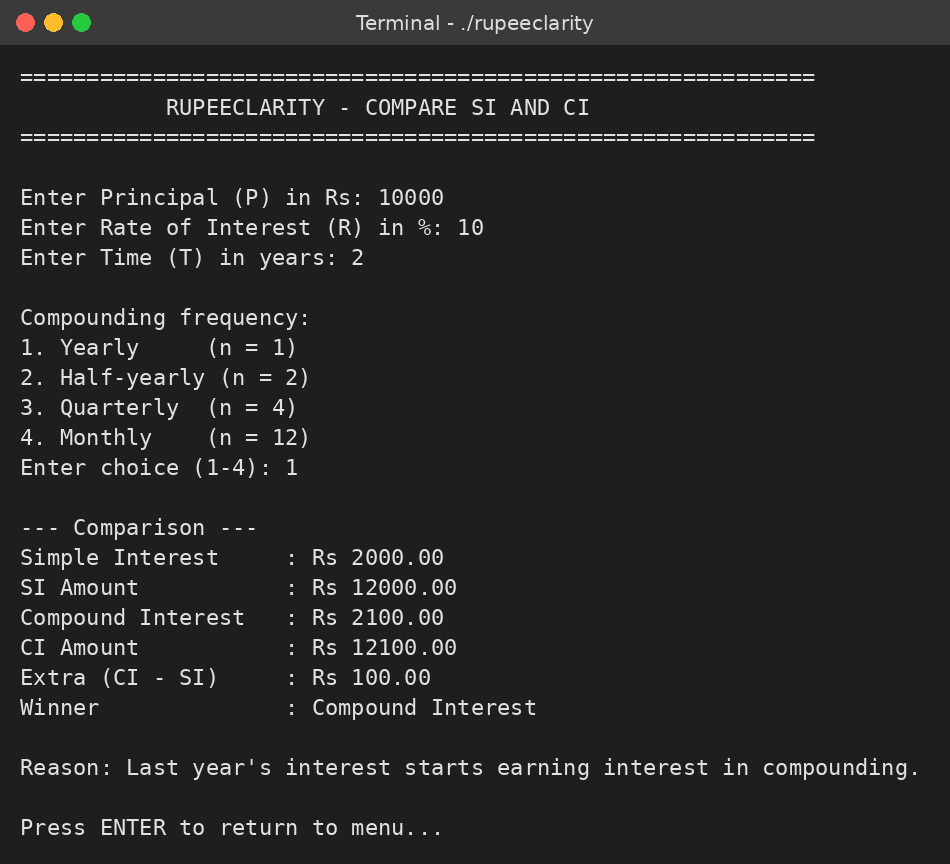
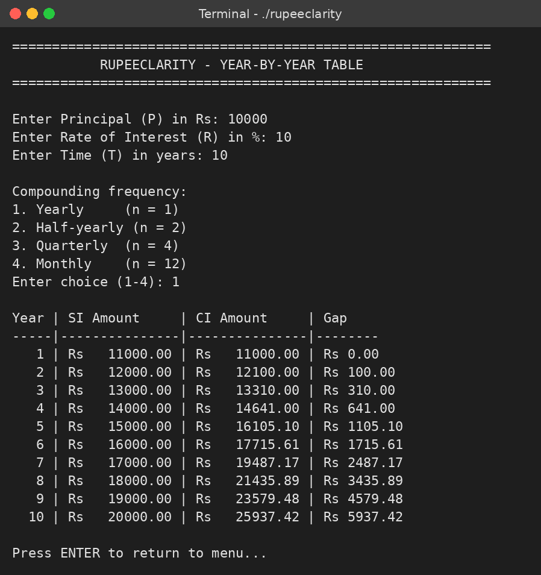
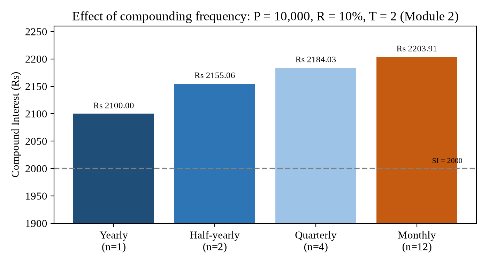

# RupeeClarity

**Interest that Talks Back** — a menu-driven C program that calculates, compares and *explains* Simple Interest and Compound Interest in Indian Rupees, without hiding the working.


---

## Overview

Most interest calculators print a single number. RupeeClarity prints the number **and the reason behind it**. It shows Simple Interest (SI) and Compound Interest (CI) side by side and builds a year-by-year table so the growing gap is visible. It also explains in plain language why compounding pays more: last year's interest goes back to work.

The whole program is one portable C99 source file. It uses only the standard library (`stdio.h`, `stdlib.h`, `math.h`, `string.h`, `ctype.h`), validates every input, and can save a plain-text report of any calculation.

### The classic example

Principal Rs 10,000 at 10% per annum for 2 years, compounded yearly (output of module 3, *Compare SI and CI*):

| Quantity | Simple Interest | Compound Interest |
|---|---:|---:|
| Interest earned | Rs 2,000.00 | Rs 2,100.00 |
| Final amount | Rs 12,000.00 | Rs 12,100.00 |
| **Extra from compounding** | — | **Rs 100.00** |

The extra Rs 100 is not a rounding error: it is the first year's Rs 1,000 interest earning 10% in the second year.

## Modules

| # | Module | What it does |
|---:|---|---|
| 1 | Simple Interest Lab | SI and amount, with the formula and working shown |
| 2 | Compound Interest Lab | CI and amount for yearly, half-yearly, quarterly or monthly compounding |
| 3 | Compare SI and CI | Side-by-side result, the extra earned and the winner |
| 4 | Year-by-Year Table | SI amount, CI amount and the gap for each year (up to 30 years) |
| 5 | Goal Check | Whether SI and CI each reach a target amount |
| 6 | What-If Rate +1% | Effect of one extra percentage point on the CI amount |
| 7 | Years to Double (Rule of 72) | Approximate doubling time using 72 / R |
| 8 | Story Mode | Plain-language explanation of why CI beats SI |
| 9 | Save Report File | Writes `rupeeclarity_report.txt` with all values |
| 10 | Formula Vault | Every formula used, with variable meanings |
| 11 | About / Project Card | Project and academic details |
| 0 | Exit | Leaves the program |

## Screenshots

| Main menu | Compare SI and CI (10000, 10%, 2 years) |
|---|---|
|  |  |

| Year-by-Year Table | Rule of 72 |
|---|---|
|  |  |

| Saved report file | About / Project Card |
|---|---|
|  |  |

Charts drawn from the program's own output:




## Build and run

### Linux / macOS

```bash
gcc src/rupeeclarity.c -o rupeeclarity -lm
./rupeeclarity
```

For a strict build: `gcc -std=c99 -Wall -Wextra src/rupeeclarity.c -o rupeeclarity -lm` (compiles with no warnings).

### Windows (MinGW-w64)

```bat
gcc src\rupeeclarity.c -o rupeeclarity.exe -lm
rupeeclarity.exe
```

Choose a module by number, enter the values when asked, and press ENTER to return to the menu. Module 9 writes `rupeeclarity_report.txt` in the current folder; an example is in [`samples/sample_report.txt`](samples/sample_report.txt).

## Project structure

```
RupeeClarity/
├── src/
│   └── rupeeclarity.c            # complete program (single file)
├── docs/
│   ├── RupeeClarity_Project_Report.docx
│   ├── RupeeClarity_Project_Report.pdf
│   └── screenshots/              # console captures and charts
├── samples/
│   └── sample_report.txt         # output of module 9
├── CHANGELOG.md
├── LICENSE
└── README.md
```

## Formulas

| Concept | Formula |
|---|---|
| Simple Interest | SI = (P × R × T) / 100 |
| SI Amount | Amount = P + SI |
| Compound Amount | A = P × (1 + R / (100 × n))^(n × T) |
| Compound Interest | CI = A − P |
| Rule of 72 | Years to double ≈ 72 / R |

P = principal (Rs), R = annual rate (%), T = time (years), n = compounding periods per year (1, 2, 4 or 12).

## Known limitations

- A decimal menu choice such as `2.5` is accepted as `2`.
- Inputs such as `12abc` (read as 12) and `inf` are accepted, because input is parsed with `sscanf`.
- Returning to the menu needs ENTER to be pressed twice after some modules.
- If standard input reaches end-of-file (for example, piped input runs out), the menu loop does not terminate.
- The year table uses whole years only and is capped at 30 rows.
- The `≈` sign in the Formula Vault may display incorrectly in older Windows consoles that are not set to UTF-8.

## Roadmap

- Read whole lines with `fgets` and parse with `strtod` / `strtol` to reject partial or non-finite input.
- Single-ENTER pause and clean exit on end-of-file.
- Monthly SIP / recurring-deposit calculator and inflation-adjusted returns.
- Appending multiple calculations to one report, with a timestamp.
- Exporting the year table as CSV for spreadsheets.

## Academic context

Developed as the mini project for **Programming in C Lab (BCA-C112)**, BCA-I, session 2026-27, at the Uttaranchal School of Computing Sciences (USCS), Uttaranchal University, Dehradun.

- **Guide:** Ms. Shivani Sisodia
- **Author:** Prafull Joshi — BCA-I, Section E, Class Roll No. 43

The full project report (analysis, design diagrams, test cases, security notes and source listing) is in [`docs/`](docs/).

## License

Released under the [MIT License](LICENSE). © 2026 Prafull Joshi.
