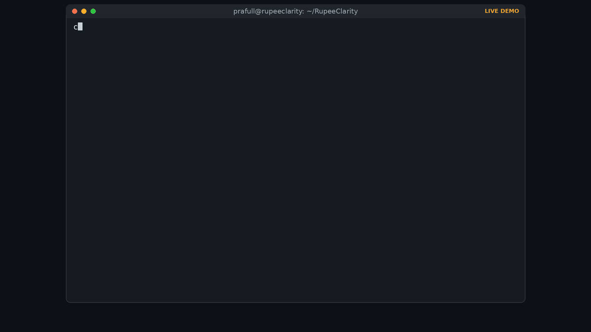
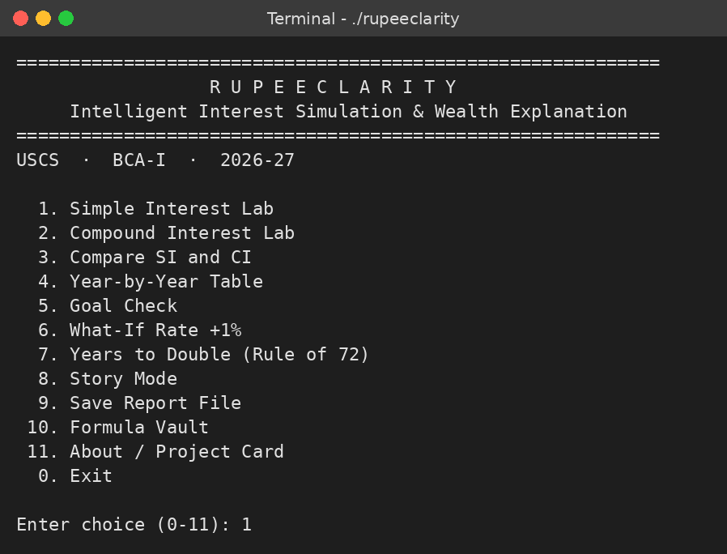
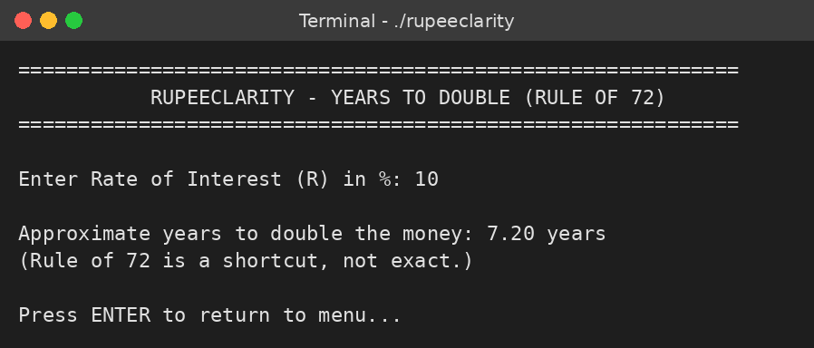
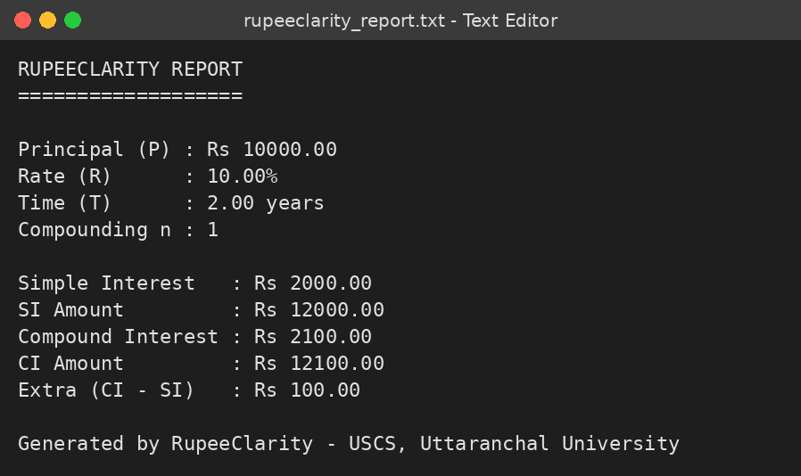
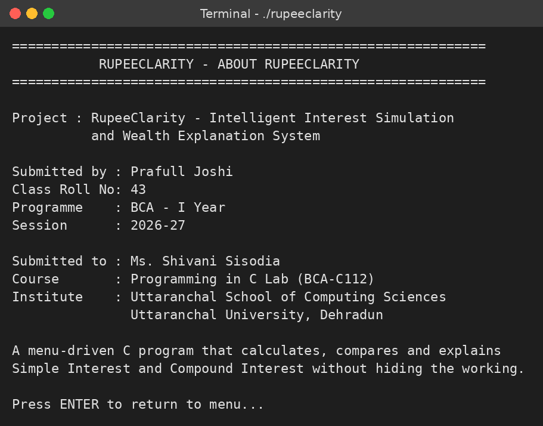
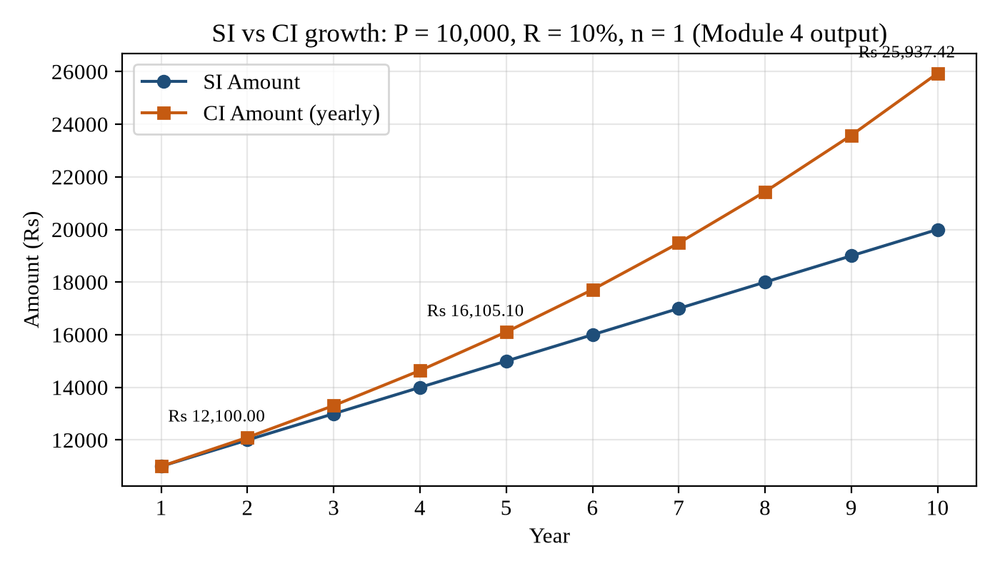

# RupeeClarity

**Interest that Talks Back** — a menu-driven C program that calculates, compares and *explains* Simple Interest and Compound Interest in Indian Rupees, without hiding the working.


[](https://codespaces.new/PrafullJ0shi/RupeeClarity)



**▶ [Watch the full demo video](docs/demo/RupeeClarity_Demo.mp4)** (8 min 47 s, 1080p). It is a real terminal session of the compiled program. It shows the build, every module from 1 to 11, the saved report file, input validation and exit.

**Try it in your browser, no install needed:** see [Run it online](#run-it-online-no-install).

---

## Overview

Most interest calculators print a single number. RupeeClarity prints the number **and the reason behind it**. It shows Simple Interest (SI) and Compound Interest (CI) side by side and builds a year-by-year table so the growing gap is visible. It also explains in plain language why compounding pays more: last year's interest goes back to work.

The whole program is one portable C99 source file. It uses only the standard library (`stdio.h`, `stdlib.h`, `math.h`, `string.h`, `ctype.h`), validates every input, and can save a plain-text report of any calculation.

### The classic example

Principal Rs 10,000 at 10% per annum for 2 years, compounded yearly (output of module 3, *Compare SI and CI*):

| Quantity | Simple Interest | Compound Interest |
|---|---:|---:|
| Interest earned | Rs 2,000.00 | Rs 2,100.00 |
| Final amount | Rs 12,000.00 | Rs 12,100.00 |
| **Extra from compounding** | — | **Rs 100.00** |

The extra Rs 100 is not a rounding error: it is the first year's Rs 1,000 interest earning 10% in the second year.

## Modules

| # | Module | What it does |
|---:|---|---|
| 1 | Simple Interest Lab | SI and amount, with the formula and working shown |
| 2 | Compound Interest Lab | CI and amount for yearly, half-yearly, quarterly or monthly compounding |
| 3 | Compare SI and CI | Side-by-side result, the extra earned and the winner |
| 4 | Year-by-Year Table | SI amount, CI amount and the gap for each year (up to 30 years) |
| 5 | Goal Check | Whether SI and CI each reach a target amount |
| 6 | What-If Rate +1% | Effect of one extra percentage point on the CI amount |
| 7 | Years to Double (Rule of 72) | Approximate doubling time using 72 / R |
| 8 | Story Mode | Plain-language explanation of why CI beats SI |
| 9 | Save Report File | Writes `rupeeclarity_report.txt` with all values |
| 10 | Formula Vault | Every formula used, with variable meanings |
| 11 | About / Project Card | Project and academic details |
| 0 | Exit | Leaves the program |

## Demo video

[`docs/demo/RupeeClarity_Demo.mp4`](docs/demo/RupeeClarity_Demo.mp4) is a complete walkthrough recorded from a real terminal session (1920×1080, H.264). Chapters:

| Time | Section |
|---|---|
| 0:00 | Intro |
| 0:09 | Build: project files, `gcc src/rupeeclarity.c -o rupeeclarity -lm`, first run |
| 0:46 | Main menu |
| 0:52 | Module 1: Simple Interest Lab (10000 @ 10% × 2 yrs; 25000 @ 7.5% × 3 yrs) |
| 1:24 | Module 2: Compound Interest Lab, yearly, half-yearly, quarterly and monthly |
| 2:37 | Module 3: Compare SI and CI (SI 2000.00 vs CI 2100.00, extra 100.00) |
| 3:17 | Module 4: Year-by-Year Table (10 years yearly; 6 years quarterly) |
| 4:00 | Module 5: Goal Check (target reached by both, by CI only, by neither) |
| 5:01 | Module 6: What-If Rate +1% |
| 5:22 | Module 7: Years to Double (Rule of 72) at 8% and 12% |
| 5:47 | Module 8: Story Mode |
| 6:10 | Module 9: Save Report File, then `cat rupeeclarity_report.txt` |
| 6:58 | Module 10: Formula Vault |
| 7:11 | Module 11: About / Project Card |
| 7:26 | Input validation: out-of-range menu choices, letters, negative and zero values |
| 8:30 | Exit |
| 8:39 | Outro |

GitHub plays MP4 files in the browser. If it asks you to download instead, use **View raw**.

## Run it online (no install)

You need only a web browser.

### Option 1: GitHub Codespaces (recommended)

[](https://codespaces.new/PrafullJ0shi/RupeeClarity)

1. Sign in to GitHub. Click the badge above, or open this repository and choose **Code → Codespaces → Create codespace on main**.
2. Wait for the codespace to start. The repository includes a [`.devcontainer`](.devcontainer/devcontainer.json) configuration with GCC preinstalled, and it compiles the program automatically.
3. In the terminal at the bottom of the page, run:

   ```bash
   gcc src/rupeeclarity.c -o rupeeclarity -lm && ./rupeeclarity
   ```

Personal GitHub accounts get a free monthly allowance of Codespaces usage. To save that allowance, stop the codespace when you finish (**Code → Codespaces → ⋯ → Stop codespace**).

### Option 2: An online C compiler (no account needed)

1. Open the source in raw form: [`src/rupeeclarity.c` (raw)](https://raw.githubusercontent.com/PrafullJ0shi/RupeeClarity/main/src/rupeeclarity.c). Select all of it and copy it.
2. Open one of these online compilers and make sure the language is **C**:
   - [OnlineGDB, Online C Compiler](https://www.onlinegdb.com/online_c_compiler)
   - [Programiz, Online C Compiler](https://www.programiz.com/c-programming/online-compiler/)
3. Delete the sample code in the editor, paste RupeeClarity's code, and press **Run**.
4. Type your menu choices and values in the console/output panel and press ENTER after each one. The program is interactive and reads from the keyboard, just as it does in a local terminal.

Notes for online compilers:

- The program uses `pow()` from `math.h`. If the build fails with `undefined reference to 'pow'`, add `-lm` to the extra compiler flags. In OnlineGDB, that field is in the settings (gear icon).
- The program clears the screen with `system("clear")`. Some web consoles cannot clear the screen, so you may see a line like `TERM environment variable not set.` or the old output may stay above the new screen. Neither affects the calculations.
- Module 9 saves `rupeeclarity_report.txt` in the online compiler's temporary sandbox. To keep it, use Codespaces or a local build.

## Screenshots

| Main menu | Compare SI and CI (10000, 10%, 2 years) |
|---|---|
|  |  |

| Year-by-Year Table | Rule of 72 |
|---|---|
|  |  |

| Saved report file | About / Project Card |
|---|---|
|  |  |

Charts drawn from the program's own output:




## Build and run

### Linux / macOS

```bash
gcc src/rupeeclarity.c -o rupeeclarity -lm
./rupeeclarity
```

For a strict build: `gcc -std=c99 -Wall -Wextra src/rupeeclarity.c -o rupeeclarity -lm` (compiles with no warnings).

### Windows (MinGW-w64)

```bat
gcc src\rupeeclarity.c -o rupeeclarity.exe -lm
rupeeclarity.exe
```

Choose a module by number, enter the values when asked, and press ENTER to return to the menu. Module 9 writes `rupeeclarity_report.txt` in the current folder; an example is in [`samples/sample_report.txt`](samples/sample_report.txt).

## Project structure

```
RupeeClarity/
├── .devcontainer/
│   └── devcontainer.json         # GitHub Codespaces setup (GCC preinstalled)
├── src/
│   └── rupeeclarity.c            # complete program (single file)
├── docs/
│   ├── RupeeClarity_Project_Report.docx
│   ├── RupeeClarity_Project_Report.pdf
│   ├── RupeeClarity_Synopsis.docx
│   ├── RupeeClarity_Synopsis.pdf
│   ├── RupeeClarity_Presentation.pptx
│   ├── RupeeClarity_Presentation.pdf
│   ├── demo/
│   │   ├── RupeeClarity_Demo.mp4     # full feature demo video
│   │   └── demo-preview.gif          # short preview used in this README
│   └── screenshots/              # console captures and charts
├── samples/
│   └── sample_report.txt         # output of module 9
├── CHANGELOG.md
├── LICENSE
└── README.md
```

## Formulas

| Concept | Formula |
|---|---|
| Simple Interest | SI = (P × R × T) / 100 |
| SI Amount | Amount = P + SI |
| Compound Amount | A = P × (1 + R / (100 × n))^(n × T) |
| Compound Interest | CI = A − P |
| Rule of 72 | Years to double ≈ 72 / R |

P = principal (Rs), R = annual rate (%), T = time (years), n = compounding periods per year (1, 2, 4 or 12).

## Known limitations

- A decimal menu choice such as `2.5` is accepted as `2`.
- Inputs such as `12abc` (read as 12) and `inf` are accepted, because input is parsed with `sscanf`.
- Returning to the menu needs ENTER to be pressed twice after some modules.
- If standard input reaches end-of-file (for example, piped input runs out), the menu loop does not terminate.
- The year table uses whole years only and is capped at 30 rows.
- The `≈` sign in the Formula Vault may display incorrectly in older Windows consoles that are not set to UTF-8.

## Roadmap

- Read whole lines with `fgets` and parse with `strtod` / `strtol` to reject partial or non-finite input.
- Single-ENTER pause and clean exit on end-of-file.
- Monthly SIP / recurring-deposit calculator and inflation-adjusted returns.
- Appending multiple calculations to one report, with a timestamp.
- Exporting the year table as CSV for spreadsheets.

## Academic context

Developed as the mini project for **Programming in C Lab (BCA-C112)**, BCA-I, session 2026-27, at the Uttaranchal School of Computing Sciences (USCS), Uttaranchal University, Dehradun.

- **Guide:** Ms. Shivani Sisodia
- **Author:** Prafull Joshi — BCA-I, Section E, Class Roll No. 43

The full project report (analysis, design diagrams, test cases, security notes and source listing) is in [`docs/`](docs/).

| Document | Formats |
|---|---|
| Project Report | [PDF](docs/RupeeClarity_Project_Report.pdf) · [DOCX](docs/RupeeClarity_Project_Report.docx) |
| Project Synopsis | [PDF](docs/RupeeClarity_Synopsis.pdf) · [DOCX](docs/RupeeClarity_Synopsis.docx) |
| Presentation | [PDF](docs/RupeeClarity_Presentation.pdf) · [PPTX](docs/RupeeClarity_Presentation.pptx) |

## License

Released under the [MIT License](LICENSE). © 2026 Prafull Joshi.
